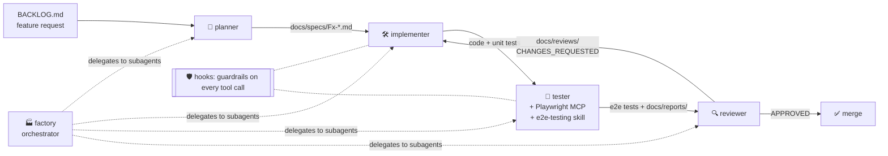

# Build your own agentic software factory with GitHub Copilot

> **Practical, about 4 hours, in pairs.** This follows the morning lecture on generative AI tools for coding.

This afternoon you won't use Copilot as an autocomplete or a chat box. You'll build a small **software factory**: a set of specialised AI agents, plus their context, tools, skills and guardrails, that turns a vague feature request into **specified, implemented, tested and reviewed** code. You'll do this on a small full-stack Kanban app.



The idea is that you don't fix the product by hand: you fix the factory. When an agent produces something wrong, improve its instructions, context, tools or skills so it does better next time. Then re-run it.

---

## Timeline

| Part                                         | Topic                                                         | Time   |
| -------------------------------------------- | ------------------------------------------------------------- | ------ |
| [0](practical/00-setup.md)                   | Setup, the Copilot harness, a tour of the app                 | 15 min |
| [1](practical/01-first-agent.md)             | **Your first agent:** the planner                             | 35 min |
| [2](practical/02-context-engineering.md)     | **Context engineering:** `AGENTS.md` and path-specific instructions | 25 min |
| [3](practical/03-factory-human-in-the-loop.md) | **The factory:** implementer, tester (+ **MCP** + **skill**), reviewer | 70 min |
| [4](practical/04-orchestrator.md)            | **The orchestrator:** chaining agents as subagents            | 45 min |
| [5](practical/05-hooks-guardrails.md)        | **Hooks and guardrails**                                      | 25 min |
| [6](practical/06-copilot-cli.md)             | _Bonus:_ the same factory from the terminal (Copilot CLI)     | 15 min |
| [7](practical/07-final-demo.md)              | **Final demo:** a secret feature, delivered by your factory   | 20 min |

There's also a [reference card](practical/reference-card.md) covering every file format used today, and a [going further](practical/going-further.md) page.

## Rules of the game

1. **Work in pairs, on one repository.** Swap who is "driving" at each part.
2. **Commit at the end of every part**, with a message like `part 1: planner agent`, and push. The CI runs on every push.
3. **Agent files, skills and instructions are written in English.** Your journal can be in English or French.
4. **Read the official docs.** Each part links to the exact page you need. The tools change every month, and the docs are the source of truth, not your memory, not the morning's slides, and not a model's training data.
5. **Watch your AI credits.** See [Part 0](practical/00-setup.md#ai-credits).
6. **Write your [JOURNAL.md](JOURNAL.md) as you go.** It's part of the validation.

## How your work is validated

This is a **pass/fail** practical. You pass when all four of these hold:

| What                     | How                                                                                                                                                                                       |
| ------------------------ | ----------------------------------------------------------------------------------------------------------------------------------------------------------------------------------------- |
| ✅ **Automated checker** | `npm run check` passes for every core part (0–5 and 7). It also runs in CI, and the result appears in the _Summary_ of each GitHub Actions run. Use `npm run check -- --part N` while you work. |
| ✅ **Quality gates (CI)** | The `Quality gates` job is green: typecheck, lint, format, unit tests and e2e tests.                                                                                                      |
| ✅ **Checkpoints**       | Each part ends with a short _definition of done_. Show it to the instructor when asked.                                                                                                   |
| ✅ **Journal and demo**  | `JOURNAL.md` is filled in honestly, and your factory delivers the secret feature in Part 7.                                                                                               |

> The checker only looks at the **structure** of your work: files, frontmatter, sections, and whether your hooks really block dangerous commands. It can't tell whether your agents are any _good_. The instructor and the final demo judge that.

## The app

`Kanban Factory` is a deliberately tiny full-stack TypeScript app:

```
server/   Express 5 + zod, in-memory store       → http://localhost:3001/api
web/      React 19 + Vite                        → http://localhost:5173
e2e/      Playwright end-to-end tests (own ports: 5174 / 3101)
checker/  The practical checker (don't modify)
docs/     specs/, reports/, reviews/: what your factory produces
```

| Command             | What it does                                                          |
| ------------------- | --------------------------------------------------------------------- |
| `npm run dev`       | Starts the API and the web app in watch mode                          |
| `npm test`          | Unit and API tests (Vitest + supertest)                               |
| `npm run test:e2e`  | End-to-end tests (Playwright). Starts its own servers                 |
| `npm run verify`    | typecheck + lint + unit + e2e. **The definition of done for code**    |
| `npm run check`     | The practical checker                                                 |

Start with **[Part 0: Setup](practical/00-setup.md)**.
